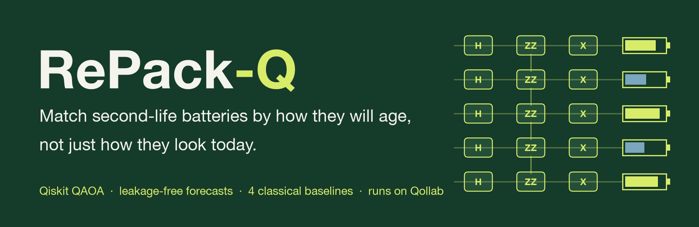
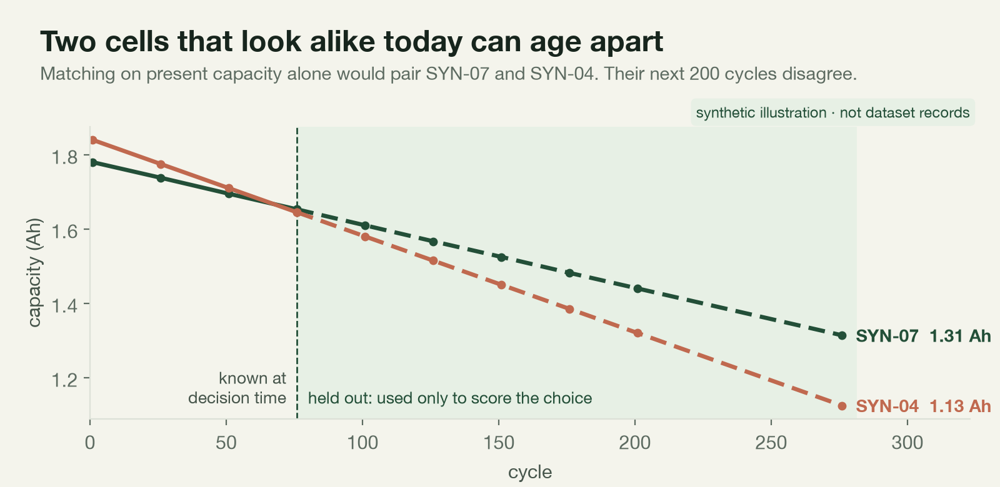
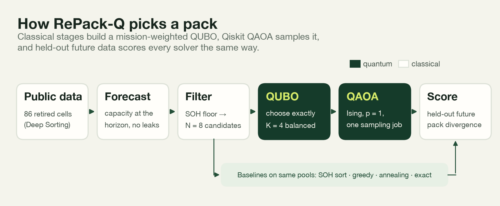
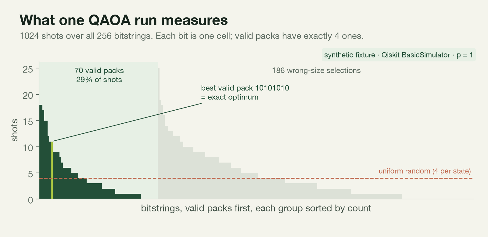
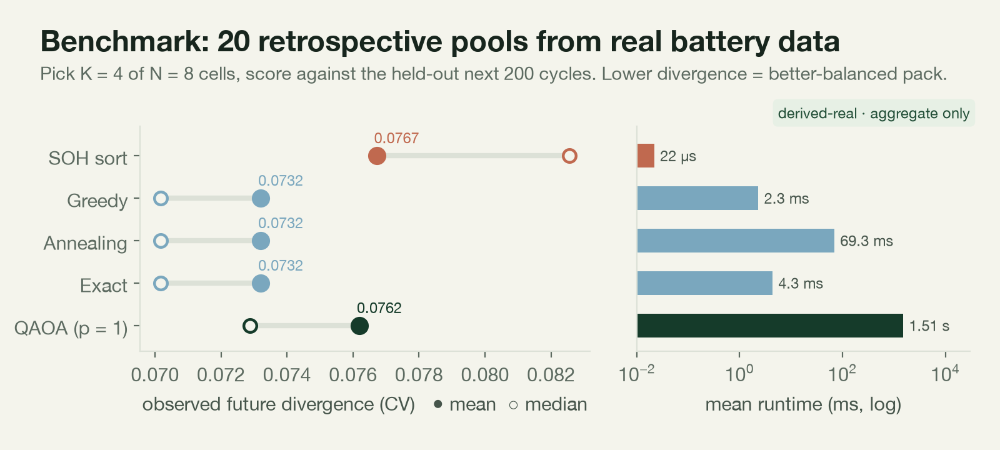
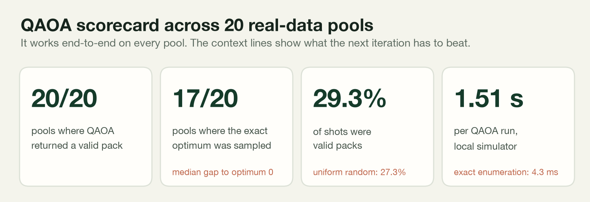
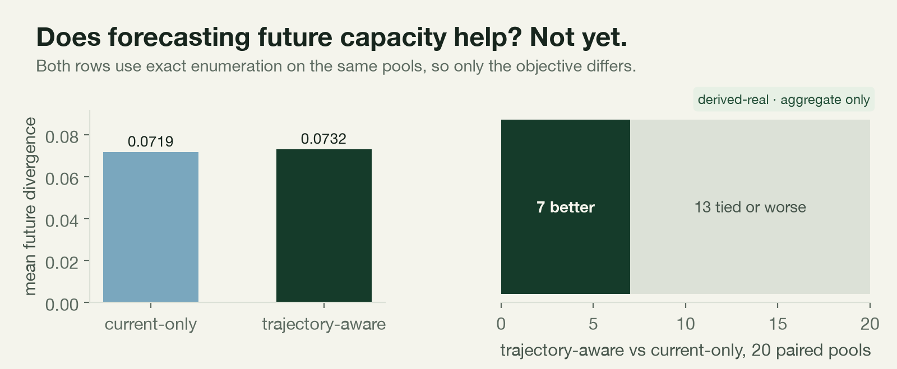

<p align="center">
  
</p>

<p align="center">
  <a href="LICENSE"></a>
  
  
  
  
</p>

<p align="center">
  <b><a href="VIDEO_URL">Demo video</a></b> &nbsp;·&nbsp;
  <b><a href="QOLLAB_URL">Run on Qollab</a></b> &nbsp;·&nbsp;
  <b><a href="#results">Results</a></b> &nbsp;·&nbsp;
  <b><a href="docs/TECHNICAL.md">Technical reference</a></b>
</p>

---

**RePack-Q** is a hybrid quantum-classical pipeline for recommissioning retired EV battery cells. It forecasts how each cell will age, encodes "pick the most compatible *K* cells" as a QUBO, samples candidate packs with **Qiskit QAOA**, and scores every choice against **held-out future measurements from a real public battery dataset**.

### TL;DR

- **Problem.** Second-life storage packs fail at their weakest cell. Matching cells on today's state of health ignores how differently they will age.
- **Approach.** A leakage-free capacity forecast feeds a mission-weighted, fixed-size QUBO. Qiskit QAOA (p = 1) samples it, and four classical solvers (SOH sort, greedy, annealing, exact) run on the same pools.
- **Result.** QAOA returned a valid pack in **20/20** real-data pools and sampled the exact optimum in **17/20**. It also beat the industry-style SOH-sort baseline on mean future divergence. We report two findings plainly: at p = 1 the sampler is close to uniform random, and the forecast term did not yet beat a current-only objective. Both point to concrete next steps.

## The problem in one picture



A series string is only as good as its weakest cell. Two cells can match today and still drift apart, and the whole pack loses usable capacity as they do. RePack-Q asks whether grouping cells on their **forecast** trajectory produces packs that stay balanced. It then tests that on real data the optimizer never saw.

## How it works



1. **Data.** The [Deep Sorting of Reused Batteries](https://doi.org/10.5281/zenodo.14859405) dataset covers 86 NMC/graphite cells over a 30-month aging campaign. We extract diagnostic capacity, resistance and temperature summaries.
2. **Forecast without leakage.** A weighted linear fit to each cell's recent capacity predicts its capacity at the mission horizon. Prediction functions reject any observation after the decision cycle (enforced by `tests/test_no_leakage.py`).
3. **QUBO.** For binary choices xᵢ (1 if cell *i* is in the pack), we minimize pairwise mismatch in normalized present capacity, resistance and forecast capacity, plus uncertainty and health terms. A calibrated penalty enforces exactly *K* cells. Over binary vectors *x* of length *N*:

<p align="center"></p>

4. **QAOA.** The QUBO maps to an Ising Hamiltonian via xᵢ = (1 − Zᵢ)/2; the mapping is verified exhaustively for N ≤ 12. Parameters are optimized on an ideal Statevector. The measured circuit is then transpiled for the backend you pick in Qollab and sent as **one sampling job**.
5. **Score.** Each solver's pack is scored on the **held-out** future capacities: observed pack divergence (CV), bottleneck capacity, objective gap and runtime.



## Run it

### On Qollab (recommended for judges)

1. Open the **[RePack-Q project on Qollab](QOLLAB_URL)** in Chrome, Edge, Brave or Firefox. Safari can't run Qollab projects yet.
2. Press **Run** and pick a **free simulator**.
3. Build a pack in the workbench, compare the classical solvers, then click **Run QAOA**. Use **Reveal future** to score your choice.

### Locally

```sh
python -m venv .venv && . .venv/bin/activate
python -m pip install -r requirements.txt
python run_repackq_web.py            # opens the workbench at http://127.0.0.1:8000/
```

```sh
PYTHONPATH=src python -m unittest discover -s tests -v   # full test suite
```

On Windows, double-click `Launch RePack-Q.bat`. Dataset preprocessing, the 20-pool benchmark, and Qollab packaging are covered in **[docs/TECHNICAL.md](docs/TECHNICAL.md)**.

## Results

Twenty fixed-seed pools from the real dataset, each choosing **K = 4 of N = 8** cells at cycle 16 and scored on the held-out next 200 cycles. Full tables and provenance hashes are in [docs/RESULTS.md](docs/RESULTS.md).



**Optimizing compatibility beats sorting by SOH.** Every QUBO-based solver, QAOA included, produced better-balanced packs on average than the SOH-sort baseline (mean divergence 0.0762 for QAOA and 0.0732 for exact vs 0.0767 for SOH sort).



**QAOA runs end-to-end on every pool.** It returns valid packs every time and hits the exact optimum in 17 of 20 pools. Our own check: at p = 1 with a standard X mixer, valid-pack shot mass (29.3%) sits just above uniform random (27.3%). The **search over packs** is doing most of the work, not amplitude concentration. That gives a clear target for the next iteration (see below). At N = 8, exact enumeration is far faster. **No quantum speedup is claimed.**



**The forecast term didn't help yet.** With the solver held fixed (exact enumeration), adding forecast capacity to the objective improved balance in 7/20 pools and was tied or worse in 13/20. We publish this negative result because the leakage-free evaluation exists to catch exactly this kind of thing.

| Method | Mean future divergence ↓ | Mean bottleneck (Ah) ↑ | Mean runtime |
|---|---:|---:|---:|
| SOH sort | 0.07672 | 1.460 | 0.02 ms |
| Greedy | 0.07321 | 1.435 | 2.3 ms |
| Simulated annealing | 0.07321 | 1.435 | 69 ms |
| Exact enumeration | 0.07321 | 1.435 | 4.3 ms |
| **QAOA, best sampled valid pack** | 0.07620 | 1.429 | 1.51 s |

Predictor check across 4,642 held-out forecasts: MAE **0.115 Ah**, median absolute error **5.6%**.

## What we learned → what's next

| Finding | Next step |
|---|---|
| p = 1 QAOA with an X mixer spends ~70% of shots on wrong-size packs | **Constraint-preserving XY mixer + Dicke-state start**, so every shot is a valid pack. Then deeper p and warm-started angles |
| Forecast term didn't beat current-only matching | Stronger degradation predictor (resistance growth, temperature), larger pools, multiple decision cycles |
| N = 8 is trivially enumerable | Scale to N = 16–24, where enumeration stops being free, and compare against the same classical baselines |
| IonQ submission from Qollab's browser runtime is blocked by its no-POST policy | Run the same circuit through a supported server-side IonQ path. The pipeline already submits one job per run |

## Limitations

- Retrospective study on one public dataset. The 20 pools are draws from one inventory and may overlap. Results are descriptive, not significance tests.
- The 200-cycle horizon is in dataset cycle indices. It is not calendar time or a real household load trace.
- The interactive app ships a **synthetic** 8-cell fixture. The dataset's license doesn't state redistribution terms, so real cell-level data stays local and only aggregate benchmark results are published.
- Not a safety tool, a lifetime guarantee, or evidence of quantum advantage. All quantum results come from simulators. No IonQ hardware result is claimed.

## Repository map

| Path | What's there |
|---|---|
| `src/repackq/` | Data adapters, leakage-free prediction, QUBO/objective, classical solvers, Qiskit QAOA engine, benchmark, UI API |
| `src/scripts/` | CLIs: inspect, preprocess, evaluate predictor, build pools, compare solvers, QAOA demo, benchmark |
| `web/` | Zero-build browser workbench, synthetic fixture, aggregate benchmark replay |
| `index.html`, `main.js`, `main.py` | Qollab entry points (HTML/JS ↔ Python bridge) |
| `tests/` | Leakage, QUBO↔Ising mapping, QAOA, solvers, dataset adapter, benchmark, UI API |
| `scripts/make_readme_figures.py` | Regenerates every figure in this README from checked-in JSON |
| `docs/` | [Results](docs/RESULTS.md) · [Technical reference](docs/TECHNICAL.md) · [Qollab notes](docs/QOLLAB_SPIKE.md) · [Demo script](docs/DEMO_SCRIPT.md) |

## Research process

RePack-Q was run as an experiment, not a demo. We fixed the question, hypotheses, metrics and seeds **before** looking at any held-out outcome, and we report the answer whether or not it favored our idea. This section walks through that process step by step, following the scientific method.

### 1. Observation

Retired EV cells usually keep 70–80% of their original capacity, which makes them candidates for stationary storage. But second-life cells come from different vehicles and duty histories, so they vary much more than new cells from one production lot. In a series string, the weakest cell limits the whole pack. Grouping cells well is therefore one of the main open problems in second-life reuse.

### 2. Background research

- **Second life.** Reviews of battery second life identify cell heterogeneity, testing cost and uncertain remaining life as key barriers to economic reuse [[1]](#ref-1).
- **Predicting degradation.** Early-cycle features can predict how a cell will age before its capacity visibly fades [[2]](#ref-2), which motivated us to group cells on predicted trajectories rather than snapshots. The Deep Sorting dataset we use was published to study exactly this kind of long-term consistency grouping [[3]](#ref-3).
- **Selection as a QUBO.** "Choose exactly K items to minimize pairwise mismatch" is a classic quadratic binary problem. Standard techniques turn the cardinality constraint into a quadratic penalty and map the QUBO to an Ising Hamiltonian, the form quantum optimizers accept [[4]](#ref-4) [[5]](#ref-5).
- **QAOA.** The Quantum Approximate Optimization Algorithm alternates a cost Hamiltonian with a mixer and is a leading near-term candidate for such problems [[6]](#ref-6). Its performance depends strongly on depth *p* and on the choice of mixer [[7]](#ref-7). Constraint-preserving mixers and Dicke-state starts keep the search inside the feasible subspace [[8]](#ref-8) [[9]](#ref-9).
- **Leakage.** Data leakage, where information from the future enters a model, is a well-documented way to get misleadingly good results. The standard remedy is a strict learn/predict separation [[10]](#ref-10).

### 3. Question and hypotheses

> **Question.** If we group cells by their *forecast* future capacity, not just their present state, do the resulting packs stay more balanced? And can QAOA solve the resulting selection problem?

- **H1 (objective).** On the same candidate pool, an exact trajectory-aware selection gives lower held-out pack divergence than an exact current-only selection.
- **H2 (solver).** p = 1 QAOA, with one sampling job, returns valid K-cell packs whose objective is at or near the exact optimum.
- **Null hypotheses.** H1: no difference in mean observed divergence. H2: QAOA's samples are no better than drawing bitstrings uniformly at random.

### 4. Experimental design

| Element | Choice | Why |
|---|---|---|
| **Data** | Public Deep Sorting dataset, 86 NMC/graphite cells | Real, longitudinal and open, and it covers second-life aging |
| **Unit of analysis** | A pool of N = 8 eligible cells at decision cycle 16; choose K = 4 | Small enough for an exact oracle, large enough to be non-trivial (70 valid packs) |
| **Independent variables** | Objective (current-only vs trajectory-aware); solver (SOH sort, greedy, annealing, exact, QAOA) | Separates *what we optimize* from *how we optimize it* |
| **Controls** | Same pools, same normalization, same scoring for every arm; exact enumeration as a ground-truth oracle | Any difference is attributable to the variable under test |
| **Dependent variables** | Observed pack divergence (CV of held-out capacity), bottleneck capacity, objective gap, feasible-shot mass, runtime | Each measures pack quality, solver quality or cost directly |
| **Blinding / leakage control** | Prediction code rejects any observation after the decision cycle; future data is read only by the scorer | Learn/predict separation, enforced by unit tests |
| **Pre-registration** | 20 seeds and all solver settings fixed in [`configs/task6_benchmark.json`](configs/task6_benchmark.json); config and input SHA-256 hashes recorded | Prevents choosing seeds or settings after seeing results |

### 5. Data collection and analysis

1. **Preprocess.** Stream raw CSVs into per-cell diagnostic trajectories (capacity, resistance, temperature) and record provenance hashes.
2. **Validate the forecaster on its own.** Before any optimization, score it on 4,642 held-out cell-by-cutoff forecasts (MAE 0.115 Ah, median error 5.6%). A forecast that couldn't predict anything would make H1 meaningless.
3. **Run the benchmark.** For each of the 20 seeded pools, run every solver and the objective ablation, then score all picks against the held-out future. The run is checkpointed so it resumes deterministically.
4. **Summarize descriptively.** Report means, medians and paired win counts. With 20 overlapping pools from one inventory, we deliberately avoid significance claims.

### 6. Results against the hypotheses

| Hypothesis | Verdict | Evidence |
|---|---|---|
| **H1**: forecasting improves balance | **Not supported** on this seed set | Current-only 0.0719 vs trajectory-aware 0.0732 mean divergence; trajectory-aware better in 7/20 pools |
| **H2**: QAOA finds near-optimal valid packs | **Supported** for finding the optimum | Valid pack in 20/20 pools; exact optimum sampled in 17/20; median gap 0 |
| **H2 null**: no better than uniform | **Not rejected** | Valid-shot mass 29.3% vs 27.3% uniform; 1,024 uniform shots would also see the optimum in about 98% of runs |
| Side result: optimization vs SOH sort | Every QUBO-based solver beat SOH sort on mean divergence | 0.0732 (exact) and 0.0762 (QAOA) vs 0.0767 (SOH sort) |

The negative H1 result is useful in its own right: a simple linear forecast doesn't yet carry enough information to change which pack is best. The H2 result shows that our pipeline is correct end to end, and that the quantum part will only earn its place once the circuit concentrates probability on good packs.

### 7. Threats to validity

- **Internal.** Pools are drawn from one inventory and can share cells, so trials are not independent. Forecast cutoffs overlap within a cell.
- **Construct.** "Divergence over 200 dataset cycles" stands in for real pack lifetime. It is not a household load trace or an electrochemical simulation.
- **External.** One chemistry, one lab and one dataset. Results may not transfer to other cells or duty cycles.
- **Statistical.** With N = 20, a mean OPD difference of 0.0013 is well within noise, so we draw no strong conclusion either way.

### 8. Iteration: the next experiment

The scientific method loops. Each result above tells us what to change next:

1. **Make QAOA beat uniform.** Swap the X mixer for a constraint-preserving XY mixer with a Dicke-state start, so every shot is a valid pack. Then test p = 2–3 with warm-started angles. New success metric: optimum-pack probability well above 1/70.
2. **Give H1 a fair second test.** Use a stronger degradation predictor (resistance growth, temperature, early-cycle features), multiple decision cycles and disjoint pools, then pre-register the new run the same way.
3. **Scale.** Move to N = 16–24, where exact enumeration stops being free, and compare QAOA against the same classical baselines on equal time budgets.
4. **Hardware.** Run the same single-job circuit on IonQ hardware once a supported submission path exists, and measure how noise changes feasible mass.

### 9. Reproducibility

Every number in this README can be regenerated. Use `src/scripts/run_benchmarks.py` with the pinned config to regenerate the benchmark ([docs/TECHNICAL.md](docs/TECHNICAL.md)), and `scripts/make_readme_figures.py` to regenerate every figure from the checked-in aggregate JSON. Provenance hashes are listed in [docs/RESULTS.md](docs/RESULTS.md).

## References

1. <a id="ref-1"></a>E. Martinez-Laserna et al., "Battery second life: Hype, hope or reality? A critical review of the state of the art," *Renewable and Sustainable Energy Reviews* 93, 701–718 (2018). [doi:10.1016/j.rser.2018.04.035](https://doi.org/10.1016/j.rser.2018.04.035)
2. <a id="ref-2"></a>K. A. Severson et al., "Data-driven prediction of battery cycle life before capacity degradation," *Nature Energy* 4, 383–391 (2019). [doi:10.1038/s41560-019-0356-8](https://doi.org/10.1038/s41560-019-0356-8)
3. <a id="ref-3"></a>Wang, Gao and Tian, *Data for: Deep sorting of reused batteries for enabling long-term consistency grouping with unknown prior conditions*, Zenodo dataset. [doi:10.5281/zenodo.14859405](https://doi.org/10.5281/zenodo.14859405)
4. <a id="ref-4"></a>A. Lucas, "Ising formulations of many NP problems," *Frontiers in Physics* 2, 5 (2014). [arXiv:1302.5843](https://arxiv.org/abs/1302.5843)
5. <a id="ref-5"></a>F. Glover, G. Kochenberger and Y. Du, "Quantum Bridge Analytics I: a tutorial on formulating and using QUBO models," *4OR* 17, 335–371 (2019). [arXiv:1811.11538](https://arxiv.org/abs/1811.11538)
6. <a id="ref-6"></a>E. Farhi, J. Goldstone and S. Gutmann, "A Quantum Approximate Optimization Algorithm" (2014). [arXiv:1411.4028](https://arxiv.org/abs/1411.4028)
7. <a id="ref-7"></a>L. Zhou, S.-T. Wang, S. Choi, H. Pichler and M. D. Lukin, "Quantum approximate optimization algorithm: performance, mechanism, and implementation on near-term devices," *Physical Review X* 10, 021067 (2020). [arXiv:1812.01041](https://arxiv.org/abs/1812.01041)
8. <a id="ref-8"></a>S. Hadfield et al., "From the Quantum Approximate Optimization Algorithm to a Quantum Alternating Operator Ansatz," *Algorithms* 12(2), 34 (2019). [arXiv:1709.03489](https://arxiv.org/abs/1709.03489)
9. <a id="ref-9"></a>A. Bärtschi and S. Eidenbenz, "Deterministic preparation of Dicke states" (2019). [arXiv:1904.07358](https://arxiv.org/abs/1904.07358)
10. <a id="ref-10"></a>S. Kaufman, S. Rosset, C. Perlich and O. Stitelman, "Leakage in data mining: Formulation, detection, and avoidance," *ACM Transactions on Knowledge Discovery from Data* 6(4), 15 (2012). [doi:10.1145/2382577.2382579](https://doi.org/10.1145/2382577.2382579)
11. <a id="ref-11"></a>Qiskit contributors, *Qiskit: an open-source framework for quantum computing*. [github.com/Qiskit/qiskit](https://github.com/Qiskit/qiskit)

## Originality, AI assistance and sources

Pre-build work consisted of problem selection, dataset research and implementation planning. Project implementation, integration, experiments, UI and submission materials were developed during the hackathon build window. Codex was used as an AI coding assistant for implementation, debugging and documentation. Claude Code was used for the final documentation, figure-generation script and README/project-page design. The project-specific data pipeline, optimization model, QAOA engine, benchmark and interface are implemented in this repository. The associated Deep Sorting code release was consulted as a schema and sampling reference only; no code from it was copied. External data and software are listed in [ATTRIBUTION.md](ATTRIBUTION.md).

## License and attribution

MIT. See [LICENSE](LICENSE). Dataset terms are separate from the software license.

**This effort is supported by Qollab & IonQ**
